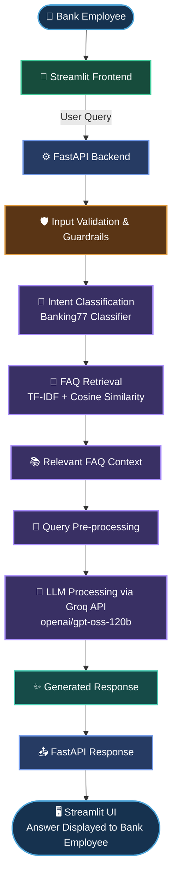

**HDFC Bank AI Assistant — Custom LLM Pipeline with RAG**

**Live Application:** https://hdfc-custom-llm-pipeline-rag-ui.onrender.com

**Backend API:** https://hdfc-custom-llm-pipeline-rag.onrender.com/

**API Documentation:** https://hdfc-custom-llm-pipeline-rag.onrender.com/docs

**Relevant Screenshots:** https://drive.google.com/drive/folders/1Qvn9Pc9wTtaPJXMUmnsZhlmM95J6th0V?usp=sharing

An employee-facing AI assistant designed to help bank employees retrieve relevant banking FAQ information and generate grounded responses using Large Language Models (LLMs), Retrieval-Augmented Generation (RAG), and intent classification.

**Table of Contents**

- "Project Overview" (#project-overview)
- "Problem Statement" (#problem-statement)
- "Objectives" (#objectives)
- "Key Features" (#key-features)
- "System Architecture" (#system-architecture)
- "Technology Stack" (#technology-stack)
- "Datasets" (#datasets)
- "Project Workflow" (#project-workflow)
- "Retrieval-Augmented Generation" (#retrieval-augmented-generation)
- "Intent Classification" (#intent-classification)
- "Evaluation Results" (#evaluation-results)
- "Application Screenshots" (#application-screenshots)
- "Project Structure" (#project-structure)
- "Local Setup" (#local-setup)
- "Deployment" (#deployment)
- "Security and Limitations" (#security-and-limitations)
- "Future Improvements" (#future-improvements)
- "Author" (#author)

---

**Project Overview**

The HDFC Bank AI Assistant is an AI-powered knowledge retrieval and question-answering application built to support bank employees in finding relevant banking information efficiently.

The system combines a custom backend pipeline, FAQ retrieval, intent classification, and an LLM accessed through Groq. The application is designed to prioritize responses grounded in the available banking knowledge base rather than relying entirely on the model's general knowledge.

**The project includes:**

- A Streamlit-based user interface.
- A FastAPI backend for processing questions.
- Retrieval-Augmented Generation (RAG) using banking FAQs.
- A TF-IDF and Logistic Regression intent classification pipeline.
- An LLM integration using "openai/gpt-oss-120b" through Groq.
- A REST API that can be tested through FastAPI Swagger documentation.

**Live Application:** https://hdfc-custom-llm-pipeline-rag-ui.onrender.com

**Backend API:** https://hdfc-custom-llm-pipeline-rag.onrender.com/

**API Documentation:** https://hdfc-custom-llm-pipeline-rag.onrender.com//docs

**Problem Statement**

Bank employees may need to consult multiple sources to answer routine banking-related questions. Manually searching for information can increase response time and lead to inconsistent answers.

This project explores how an AI-powered retrieval and question-answering system can help employees find relevant information from a structured FAQ knowledge base.

The application is a project prototype and is not an official HDFC Bank product.

**Objectives**

1. Build a custom question-answering pipeline using an LLM.
2. Retrieve relevant information from a banking FAQ knowledge base.
3. Use intent classification to identify the category of incoming queries.
4. Develop a REST API using FastAPI.
5. Create an interactive interface using Streamlit.
6. Evaluate the intent classifier, retrieval component, and response-generation pipeline separately.
7. Deploy the backend and frontend for demonstration.

**Key Features**

- Banking FAQ retrieval: Searches a curated FAQ dataset for relevant information.
- LLM-powered responses: Uses Groq to access the "openai/gpt-oss-120b" model.
- RAG pipeline: Supplies retrieved FAQ context to the LLM when generating responses.
- Intent classification: Uses TF-IDF features and Logistic Regression to classify queries into Banking77 intent categories.
- REST API: Exposes the question-answering functionality through FastAPI.
- Interactive interface: Allows users to submit questions through Streamlit.
- API documentation: Supports endpoint testing through Swagger UI.
- Modular pipeline: Separates retrieval, classification, API handling, and response generation.

## 🏦 HDFC Bank AI Assistant – System Workflow

The architecture represents the intended application flow. The exact runtime path depends on the implementation of the deployed version.

**Technology Stack**

Component| Technology
Programming language| Python
Frontend| Streamlit
Backend| FastAPI
API server| Uvicorn
LLM provider| Groq
LLM model| "openai/gpt-oss-120b"
FAQ retrieval| TF-IDF and cosine similarity
Intent classification| TF-IDF and Logistic Regression
Data processing| Pandas, NumPy
Machine learning| Scikit-learn
Configuration| Python-dotenv
API testing| FastAPI Swagger UI
Deployment| Render
Version control| Git and GitHub

**Datasets**

**1. Banking FAQs**

The FAQ dataset contains questions, answers, and class/category labels related to banking.

Property| Details
Original dataset| BankFAQs
Main columns| "Question", "Answer", "Class"
Rows before duplicate-question removal| 1,499
Unique questions after duplicate-question removal| 1,339
Primary purpose| FAQ retrieval and grounded response generation

The dataset was cleaned and prepared for use in the retrieval pipeline.

**2. Banking77**

Banking77 is a banking-related intent classification dataset containing 77 intent categories.

Split| Examples| Categories
Training| 10,003| 77
Testing| 3,080| 77

The intent classification pipeline uses TF-IDF to transform text into numerical features and Logistic Regression to predict the intent category.

**Project Workflow**

**Step 1: Data Preparation**

- Load the FAQ and Banking77 datasets.
- Inspect dataset structure and missing values.
- Identify duplicate records.
- Remove duplicate FAQ questions as part of dataset preparation.
- Prepare text fields for downstream processing.
- Preserve relevant question, answer, and category information.

**Step 2: Intent Classification**

- Convert text into numerical features using TF-IDF.
- Train a Logistic Regression classifier.
- Evaluate predictions on the Banking77 test dataset.
- Measure accuracy, macro-F1, and weighted-F1.

**Step 3: FAQ Retrieval**

- Represent FAQ questions using TF-IDF.
- Compare the incoming query against the FAQ question representations.
- Use cosine similarity to identify relevant FAQ entries.
- Pass retrieved context to the response-generation component.

**Step 4: LLM Response Generation**

- Send the user's question and retrieved context to the LLM through Groq.
- Generate a response using the supplied information.
- Return the response to the application interface.

**Step 5: API Development**

- Implement question-answering functionality through FastAPI.
- Expose the "/ask" endpoint.
- Use Uvicorn to run the API server.
- Validate API functionality using the "/docs" interface.

**Step 6: Frontend Development**

- Build the interactive interface using Streamlit.
- Connect the frontend to the deployed backend API.
- Display responses to submitted questions.

**Step 7: Evaluation and Deployment**

- Evaluate intent classification separately.
- Assess FAQ retrieval using similarity-based evaluation.
- Test baseline LLM generation and RAG response generation.
- Deploy the backend and frontend as separate services on Render.

**Retrieval-Augmented Generation (RAG)**

Retrieval-Augmented Generation combines information retrieval with LLM-based response generation.

Instead of relying only on the LLM's internal knowledge, the pipeline retrieves potentially relevant FAQ information and supplies it as context.

**RAG workflow**

1. Receive a banking-related question.
2. Transform the query into a TF-IDF representation.
3. Calculate cosine similarity against stored FAQ representations.
4. Retrieve relevant FAQ information.
5. Provide the question and retrieved context to the LLM.
6. Return the generated response.

**Why RAG?**

- Provides access to project-specific FAQ information.
- Can improve relevance when the retrieved context matches the query.
- Makes it possible to update the knowledge base without retraining the LLM.
- Supports a more controlled question-answering workflow.

Important: Retrieval does not guarantee correctness. Responses must still be evaluated for factual accuracy, relevance, and whether they are supported by the retrieved context.

**Intent Classification**

The intent classification component uses the Banking77 dataset.

**Model pipeline**

"Input Text → TF-IDF Vectorization → Logistic Regression → Predicted Intent"

TF-IDF converts text into numerical features based on term importance. Logistic Regression learns to distinguish between the 77 intent categories.

The classifier is a separate component from the LLM. It predicts an intent category; it does not itself generate the final natural-language answer.

**Evaluation Results**

1. Banking77 Intent Classification

Metric| Result
Test examples| 3,080
Intent categories| 77
**Accuracy**| 88.71%
**Macro-F1**| 88.88%
**Weighted-F1**| 88.88%

Interpretation: The classifier achieved 85.71% accuracy on the test dataset. Macro-F1 gives equal weight to each intent category, while weighted-F1 accounts for the number of examples in each category.

**2. FAQ Retrieval Evaluation**

Metric| Result
**Evaluation questions**| 268
**Average best-answer cosine similarity**| 0.68
**Questions with best similarity ≥ 0.70**| 47.39%

These similarity results are retrieval diagnostics, not verified answer-correctness scores. A high cosine similarity does not necessarily mean that the retrieved answer is correct.

3. Baseline LLM Evaluation

The baseline evaluation attempted to generate answers without the FAQ retrieval component.

Metric| Result
**Evaluation questions**| 268
**Successful responses**| 76
**Failed responses|** 192
**Average latency**| 1.24 seconds

The 192 failures were generation/API or script-level failures in the evaluation run. They must not be interpreted as 192 incorrect answers.

Because many requests failed, these results do not provide a fair answer-quality comparison against RAG.

**4. RAG LLM Evaluation**

Metric| Result
**Evaluation questions| 268
Successful responses**| 268
**Failed responses**| 0
**Average latency**| 4.15 seconds

The RAG evaluation completed all 268 response-generation attempts successfully in the recorded run.

Interpretation: RAG achieved a higher successful-response count in this evaluation run, with an average latency of 4.15 seconds. Successful generation alone does not establish answer correctness. A fair quality comparison requires both systems to be evaluated on the same successfully processed questions using consistent correctness criteria.

**Project Structure**

The following is a representative structure. Adjust filenames to match the actual repository.

HDFC-Custom-LLM-Pipeline-RAG/
│
├── data/
│   ├── BankFAQs.csv
│   └── cleaned/
│       └── BankingFAQs.csv
│
├── .streamlit/
│   └── secrets.toml
│
├── main.py
├── rag.py
├── pdf_rag.py
├── Streamlit.py
├── guardrails.py
├── evaluate_test.py
├── requirements.txt
├── .gitignore
└── README.md

Only include files and folders that actually exist in the repository. Do not commit API keys, passwords, or other secrets.

Local Setup

**Prerequisites**

- Python 3.10 or another version supported by the project's dependencies.
- Git.
- A Groq API key.
- The required project datasets.

**1. Clone the Repository**

git clone <YOUR_GITHUB_REPOSITORY_URL>
cd HDFC-Custom-LLM-Pipeline-RAG

**2. Create a Virtual Environment**

python -m venv venv

Activate it on Windows:

venv\Scripts\activate

**3. Install Dependencies**

pip install -r requirements.txt

**4. Configure Environment Variables**

Create a ".env" file in the project root if the backend expects it:

GROQ_API_KEY=your_groq_api_key
USER_AGENT=HDFC-Bank-AI-Assistant/1.0

Replace the example value with your own key locally. Never commit this file to GitHub.

**5. Configure the Frontend**

If the application uses Streamlit secrets, configure the values expected by the actual frontend code in ".streamlit/secrets.toml".

Example:

API_BASE_URL = "http://127.0.0.1:8000"
ADMIN_PASSWORD = "replace-with-a-strong-password"

Use the actual configuration keys required by the application. Do not publish a real admin password.

**6. Start the Backend**

uvicorn main:app --reload

Open the API documentation:

http://127.0.0.1:8000/docs

**7. Start the Frontend**

In a separate terminal:

streamlit run Streamlit.py

The frontend must point to the running backend API. If the frontend and backend use different configuration files or environment variables, configure them accordingly.

Deployment

The application is deployed as separate backend and frontend services on Render.

Backend

- Framework: FastAPI
- ASGI server: Uvicorn
- Build command: "pip install -r requirements.txt"
- Start command:

uvicorn main:app --host 0.0.0.0 --port $PORT

Configure "GROQ_API_KEY" through the service's environment-variable settings.

Frontend

- Framework: Streamlit
- Build command: "pip install -r requirements.txt"
- Start command:

streamlit run Streamlit.py --server.address 0.0.0.0 --server.port $PORT

Configure "API_BASE_URL" with the deployed backend base URL. Configure any other required frontend secrets using the method supported by the application.

Live Links

- Frontend: Add deployed Streamlit URL.
- Backend: Add deployed FastAPI URL.
- Swagger API Docs: Add backend URL followed by "/docs".

Test the deployed frontend and verify that it can communicate with the deployed backend before marking the application as live.

Security and Limitations

- API keys and passwords must be stored in environment variables or an appropriate secrets mechanism.
- Do not commit ".env" or files containing real credentials.
- A retrieved FAQ can be irrelevant or incomplete; similarity scores are not proof of correctness.
- LLM-generated responses can contain errors or unsupported claims.
- The recorded baseline evaluation had substantial generation/API or script-level failures and requires investigation.
- The recorded evaluation metrics are specific to the datasets and evaluation runs used in this project.
- The project is a prototype for demonstration and learning. It is not an official HDFC Bank system and should not be used for real banking decisions without appropriate authorization, validation, security controls, and compliance review.

**Future Improvements**

- Add a formal answer-correctness evaluation with a validated test set.
- Compare baseline and RAG on the same successfully processed questions.
- Investigate and resolve baseline generation/API failures.
- Evaluate retrieval quality using precision, recall, and ranking metrics where suitable labels are available.
- Add a confusion matrix and per-class precision, recall, and F1-score for intent classification.
- Improve retrieval through alternative embedding and reranking methods.
- Add automated testing, monitoring, and latency tracking.
- Strengthen prompt-injection defenses and output-grounding checks.
- Improve observability and error handling for deployed services.

**Author**

**Tanuj Verma**

**Data Science and AI | Machine Learning | Generative AI**

**GitHub: [https://github.com/]**

---

This project was developed for educational and portfolio purposes to demonstrate an end-to-end AI application involving data preparation, intent classification, FAQ retrieval, LLM integration, API development, frontend development, evaluation, and deployment.
